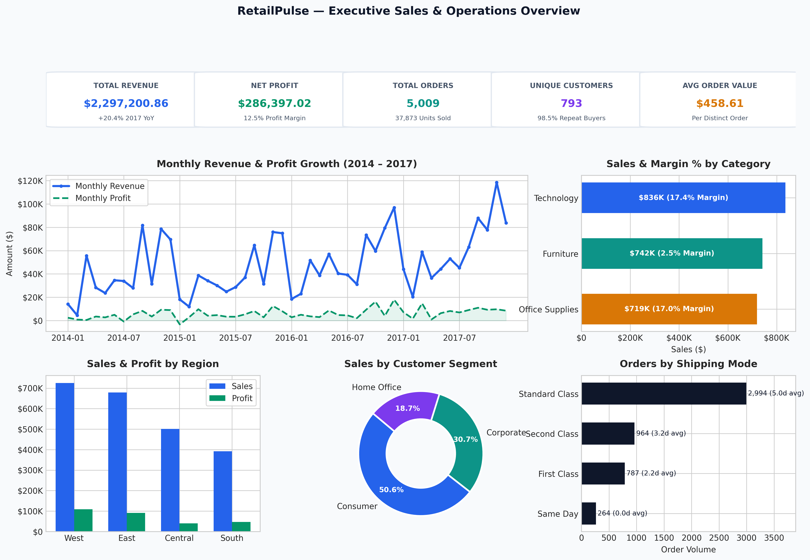
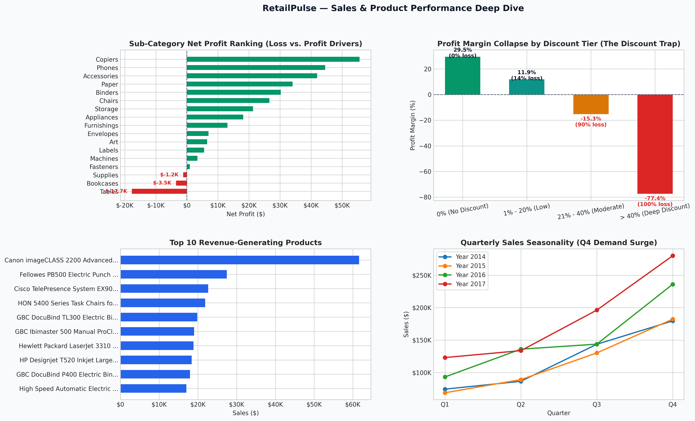
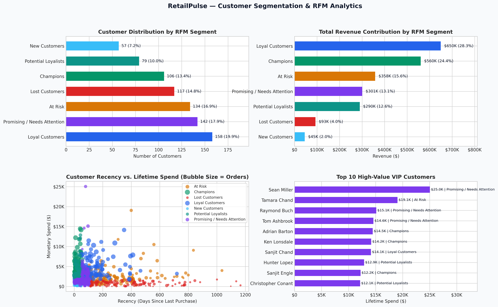
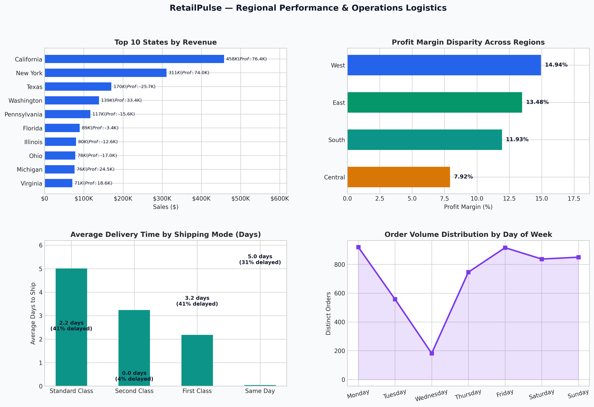

# RetailPulse — E-Commerce Sales & Customer Analytics

[](https://www.python.org/)
[](https://pandas.pydata.org/)
[](https://www.mysql.com/)
[](https://www.microsoft.com/excel)
[](https://powerbi.microsoft.com/)
[](LICENSE)

> **Portfolio-Grade End-to-End Data Analytics Project**  
> Developed by a 4th-Year B.Tech Data Science Student targeting **Data Analyst / Business Analyst / Junior Data Analyst** roles.

---

## 📌 1. Project Overview

An established e-commerce retail enterprise generating over **$2.29M in revenue** across 4 years wanted to diagnose its sales drivers, customer lifetime value, geographic profitability, and fulfillment logistics. Despite steady top-line revenue growth (+20.4% YoY in 2017), executive leadership was concerned about **profit margin compression, high customer churn risk, and severe losses in specific product categories**.

This project provides an end-to-end analytical solution—spanning **Python data cleaning and feature engineering, exploratory data analysis (EDA), MySQL 8+ business queries, Excel financial modeling, customer RFM segmentation, and an interactive 4-page Power BI dashboard**—to deliver actionable, revenue-protecting business recommendations.

```
┌──────────────┐     ┌──────────────────┐     ┌──────────────────┐     ┌──────────────────┐
│  Raw Dataset │ ──► │ Python Cleaning  │ ──► │  EDA & Visuals   │ ──► │  MySQL Business  │
│  (9,994 rows)│     │ & Feature Eng.   │     │  (Pandas/Seaborn)│     │  Analysis (CTEs) │
└──────────────┘     └──────────────────┘     └──────────────────┘     └──────────────────┘
                                                                                 │
┌──────────────┐     ┌──────────────────┐     ┌──────────────────┐               │
│  Executive   │ ◄── │ Power BI Model   │ ◄── │ Excel Financial  │ ◄─────────────┘
│  Insights    │     │ & 15+ DAX Metrics│     │ & Pivot Analysis │
└──────────────┘     └──────────────────┘     └──────────────────┘
```

---

## 🎯 2. Business Objectives & Analytical Scope

1. **Revenue & Profit Dynamics**: Evaluate historical revenue trajectories, Year-over-Year (YoY) growth, and seasonal quarterly demand surges.
2. **Product Profitability & The "Discount Trap"**: Identify high-margin profit engines versus loss-making SKUs, and calculate the exact discount threshold where transactions turn negative.
3. **Customer Behavioral RFM Segmentation**: Quantify customer concentration, repeat purchase frequency, and detect at-risk VIP accounts to prevent customer churn.
4. **Geographic & Territorial Diagnostics**: Uncover regional profit margin disparities between the West and Central territories.
5. **Logistics & Operations**: Audit carrier fulfillment cycle times and SLA breach rates across shipping tiers.

---

## 📊 3. Core Business KPIs

| Key Performance Indicator | Value | Business Context |
| :--- | :---: | :--- |
| **Total Revenue** | **$2,297,200.86** | 4-year cumulative gross sales |
| **Total Net Profit** | **$286,397.02** | Bottom-line net earnings |
| **Overall Profit Margin %** | **12.47%** | Net margin across all 9,994 order lines |
| **Total Distinct Orders** | **5,009** | Total orders fulfilled |
| **Total Units Sold** | **37,873** | Physical inventory units moved |
| **Total Unique Customers** | **793** | Registered B2C & B2B accounts |
| **Repeat Customer Rate %** | **98.49%** | 781 out of 793 customers placed $\ge 2$ orders |
| **Average Order Value (AOV)** | **$458.61** | Revenue per distinct order ($229.86 per line item) |
| **Average Shipping Duration** | **3.96 Days** | Mean cycle time from order placement to dispatch |
| **Loss-Making Transactions** | **18.72%** | 1,871 order lines generated negative profit |

---

## 💡 4. Top Analytical Findings & Strategic Recommendations

### 🔴 1. The Discount Trap — Uncontrolled Discounts Beyond 20% Destroy Margins
- **Data Finding**: Undiscounted orders (0% discount) delivered a **+29.51% profit margin** ($321.0K profit) with **0% loss transactions**. Moderate discounts (21%–40%) plummeted margins to **-15.30%** (90.2% loss rate), and deep discounts (>40%) collapsed margins to **-77.40%** with a **100.0% loss rate** ($99.6K loss across 933 transactions).
- **Recommendation**: Implement an automated ERP discount lock capping sales rep discounts at **15% max**. Require VP/Finance approval for 16%–20%, and replace clearance discounts with bundle promotions.

### 🔴 2. Sub-Category Deficit — Tables & Bookcases Bleed $21.2K in Losses
- **Data Finding**: `Tables` generated **$206,965.53 in sales** but suffered a **-$17,725.48 net loss** (-8.56% margin; 63.6% loss order rate) due to excessive 26.1% average discounting and bulky freight costs. `Bookcases` lost **-$3,472.56**.
- **Recommendation**: Raise table list prices by 8–10%, eliminate promotional discounts >10% on bulky furniture, and renegotiate supplier terms on bottom 5 loss-making SKUs.

### 🟢 3. High-Margin Engines — Copiers, Paper, and Accessories
- **Data Finding**: `Copiers` achieved a **37.20% margin** (+$55.62K profit across 68 orders) with **0.0% loss orders**. `Paper` generated **43.39% margin** (+$34.05K profit across 1,370 orders).
- **Recommendation**: Create bundled corporate supply packages (e.g., Copier hardware paired with recurring Paper and Toner subscription contracts) to boost recurring high-margin cash flows.

### 🟡 4. Geographic Margin Disparity — Central Region Underperformance
- **Data Finding**: The West region delivered a **14.94% profit margin** ($108.4K profit on $725.5K sales), whereas the Central region lagged at **7.92% margin** ($39.7K profit on $501.2K sales), directly caused by high average discounting (17.16%) in Texas and Illinois.
- **Recommendation**: Shift Central territory sales commissions from gross revenue quotas to **Net Gross Margin quotas** to discourage price discounting.

### 👥 5. Customer Concentration & At-Risk VIP Cohort
- **Data Finding**: **Champions and Loyal Customers (33.3% of accounts)** generated **52.67% of total revenue** ($1.21M). However, the **At-Risk segment represents 134 high-value customers ($358.2K historical spend)** who have been inactive for an average of **281.5 days (>9 months)**.
- **Recommendation**: Trigger an automated win-back campaign offering personalized recommendations and a $50 loyalty credit on orders over $300 for customers inactive >180 days.

---

## 📈 5. Dashboard Visualizations

### 1. Executive Overview Dashboard


### 2. Sales & Product Performance Deep Dive


### 3. Customer Analytics & RFM Segmentation


### 4. Regional & Operations Logistics


---

## 🛠️ 6. Tools & Technologies Used

- **Python 3.10+**: Data cleaning pipeline, statistical audit, feature engineering, RFM scoring.
- **Pandas & NumPy**: Tabular manipulation, vectorized calculations, quantile segmentation.
- **Matplotlib & Seaborn**: High-resolution, multi-panel exploratory data visualizations (300 DPI).
- **SQL (MySQL 8.0+ / ANSI SQL)**: Relational schema design, CTEs, Window Functions (`LAG`, `NTILE`, `DENSE_RANK`, `SUM OVER`), aggregate queries.
- **Microsoft Excel**: Dynamic financial modeling, `=SUMIFS`, `=COUNTIFS`, `=IFERROR`, `=XLOOKUP`, KPI cards, and native Excel charts.
- **Power BI**: Star Schema data modeling, 15+ production DAX measures, time-intelligence, multi-page interactive BI dashboard.

---

## 🗂️ 7. Repository Structure

```text
RetailPulse/
│
├── data/
│   ├── raw/
│   │   └── retailpulse_raw.csv                <- Original authenticated raw dataset (9,994 rows)
│   └── processed/
│       ├── retailpulse_cleaned.csv            <- Cleaned dataset with 14 engineered features (45 cols)
│       └── retailpulse_customer_rfm.csv       <- Customer-level aggregated RFM metrics (793 rows)
│
├── python/
│   ├── data_cleaning.py                       <- Reproducible cleaning, feature engineering & RFM pipeline
│   ├── eda.py                                 <- Exploratory Data Analysis & visual chart generator
│   └── build_excel.py                         <- Programmatic builder for multi-tab Excel model
│
├── sql/
│   ├── data_quality.sql                       <- DDL schema, table creation & data audit queries
│   ├── sales_analysis.sql                     <- Revenue KPIs, YoY growth (LAG), seasonality & discount impact
│   ├── product_analysis.sql                   <- Category/Sub-category margins, Top 10 products, loss analysis
│   └── customer_analysis.sql                  <- CLV ranking, repeat rates, SQL-native RFM & churn risk
│
├── excel/
│   └── RetailPulse_Analysis.xlsx              <- Polished multi-tab workbook with formulas & native charts
│
├── powerbi/
│   ├── README.md                              <- Step-by-step Power BI build guide & Star Schema blueprint
│   └── dax_measures.dax                       <- Standalone repository of 15+ production DAX measures
│
├── reports/
│   ├── business_insights.md                   <- In-depth business report (Finding, Evidence, Meaning, Rec)
│   └── data_quality_report.md                 <- Data dictionary, validation audit & limitations report
│
├── screenshots/
│   ├── executive_dashboard.png                <- Page 1: Executive Overview visualization
│   ├── sales_dashboard.png                    <- Page 2: Sales & Product Deep Dive visualization
│   ├── customer_dashboard.png                 <- Page 3: Customer Analytics & RFM visualization
│   └── regional_operations_dashboard.png      <- Page 4: Regional & Logistics Operations visualization
│
├── requirements.txt                           <- Python environment dependencies
├── README.md                                  <- Recruiter-friendly portfolio documentation
└── LICENSE                                    <- MIT Open-Source License
```

---

## 🚀 8. How to Run & Reproduce

### Step 1: Clone Repository & Install Dependencies
```bash
git clone https://github.com/Yamini-Katuri/RetailPulse.git
cd RetailPulse
pip install -r requirements.txt
```

### Step 2: Run Data Cleaning & Feature Engineering
```bash
python python/data_cleaning.py
```
*Outputs: `data/processed/retailpulse_cleaned.csv` and `data/processed/retailpulse_customer_rfm.csv`.*

### Step 3: Run Exploratory Data Analysis (EDA)
```bash
python python/eda.py
```
*Generates all 4 high-resolution dashboard figures in `screenshots/`.*

### Step 4: Build Excel Analysis Model
```bash
python python/build_excel.py
```
*Generates `excel/RetailPulse_Analysis.xlsx` with dynamic formulas and native embedded charts.*

### Step 5: Execute MySQL Analysis
1. Open MySQL Workbench / CLI.
2. Run `sql/data_quality.sql` to initialize database and run quality audits.
3. Import `data/processed/retailpulse_cleaned.csv` into `retailpulse_orders` table.
4. Run `sql/sales_analysis.sql`, `sql/product_analysis.sql`, and `sql/customer_analysis.sql`.

### Step 6: Power BI Desktop Reproduction
1. Open Power BI Desktop and import `data/processed/retailpulse_cleaned.csv`.
2. Follow the Star Schema model and DAX measures provided in [`powerbi/README.md`](powerbi/README.md) and [`powerbi/dax_measures.dax`](powerbi/dax_measures.dax).

---

## 🎓 9. Practical Skills Demonstrated

- **Business Problem Structuring**: Translating vague leadership questions into measurable quantitative metrics.
- **Data Wrangling & Pipeline Reproducibility**: Clean, documented Python ETL script handling edge cases, text trimming, and zero-padded zip codes.
- **Feature Engineering**: Creating temporal fields, logistics cycle times, unit economics, and margin classifications.
- **Advanced SQL Querying**: Window functions (`LAG`, `NTILE`, `DENSE_RANK`), Common Table Expressions (CTEs), multi-level aggregations, and subqueries.
- **Customer Segmentation (RFM)**: Mathematical quantile scoring and behavioral segmentation without overcomplicating with black-box ML.
- **Financial & Excel Modeling**: Multi-tab workbook architecture with dynamic formula references, conditional logic, and pivot-style summaries.
- **BI Dashboard Design & DAX**: Star Schema architecture, time intelligence measures, and executive UX hierarchy.
- **Executive Communication**: Structuring findings using the **Finding ➔ Evidence ➔ Business Meaning ➔ Recommendation** framework.

---

## 📄 10. License

This project is licensed under the [MIT License](LICENSE).
